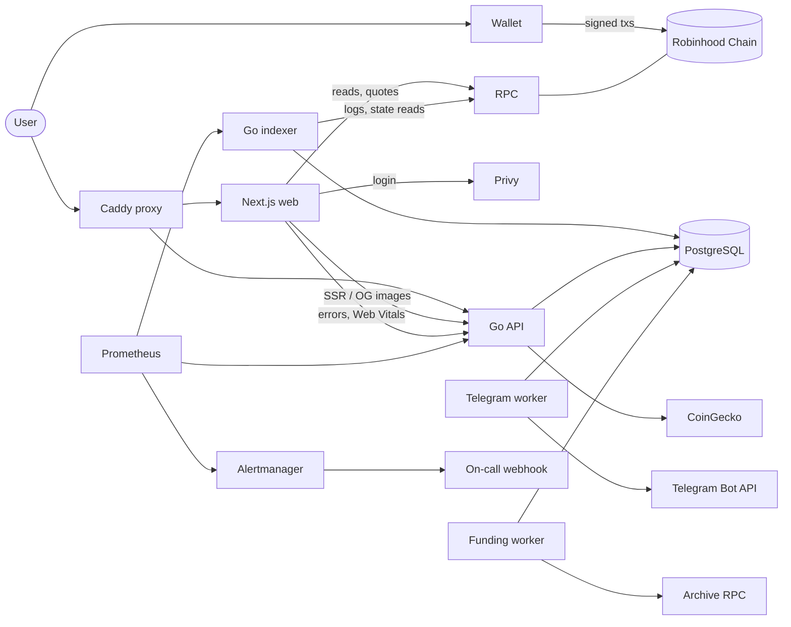

# Architecture overview

One page that names every running part of launchpad and how data moves between them. It is the
narrative companion of the `launchpad` design in the system-design record, which holds the same
components as a diagram plus the decision history behind each one. Component names in
`code font` are the record's component ids.

Keep the two in step: a change that adds, removes or rewires a component records an `add_step`
in the design **and** updates this page in the same commit.

## System at a glance

The platform is non-custodial: every launch, trade and claim is a transaction the user's (`user`)
wallet signs and sends. The backend only reads the chain; it never holds keys or user funds.

## On-chain contracts

Two launch engines run side by side. Each token belongs to exactly one engine for its whole life.

| Engine | Component (record id) | Source | Role |
|---|---|---|---|
| 1 | LaunchFactory (`factory-v1`) | `contracts/src/LaunchFactory.sol` | Deploys a token and its curve per launch, holds future-launch config, owner can pause curve buys. |
| 1 | BondingCurveV1 (`curve-v1`) | `contracts/src/BondingCurveV1.sol` | Virtual-reserve curve with fees and refunds. The buy that fills it graduates the token. |
| 1 | LaunchToken (`token-v1`) | `contracts/src/LaunchToken.sol` | Fixed-supply ERC-20, minted once. |
| 1 | Uniswap v2 pair (`uniswap-v2`) | external | Graduated pool. The initial LP tokens are sent to `0x…dEaD`. |
| 2 | LaunchFactoryV2 (`factory-v2`) | `contracts/src/v2/LaunchFactoryV2.sol` | Deploys token and curve clone, snapshots launch config, wires the hook and locker once. |
| 2 | BondingCurveV2 (`curve-v2`) | `contracts/src/v2/BondingCurveV2.sol` | Engine 1 curve maths plus an outer anti-snipe tax. Graduation initializes the guarded v4 pool and mints a full-range position to the locker. |
| 2 | LaunchTokenV2 (`token-v2`) | `contracts/src/v2/LaunchTokenV2.sol` | Fixed-supply ERC-20 with no owner, mint, tax, blacklist or pause. |
| 2 | GraduationGuardHook (`guard-hook`) | `contracts/src/v2/GraduationGuardHook.sol` | v4 hook with only `beforeInitialize`: only the token's own curve may create its pool. |
| 2 | LpFeeLocker (`lp-locker`) | `contracts/src/v2/LpFeeLocker.sol` | Holds every position NFT forever and splits collected LP fees between creator and protocol. |
| 2 | Uniswap v4 (`uniswap-v4`, `universal-router`, `permit2`, `v4-quoter`) | external | PoolManager, PositionManager and the router stack graduated trades go through. |

Curve maths is single-sourced: `contracts/vectors/v1/` holds the test vectors that both Solidity
and `backend/internal/curve` must reproduce. Design: `docs/specs/2026-09-01-contract-core-design.md`
(engine 1) and `docs/specs/2026-11-11-v2-engine-design.md` (engine 2). The testnet path
(`testnet-v4`, `testnet-engine-v2`) self-deploys the v4 stack:
`docs/specs/2026-11-18-v2-testnet-path-preflight.md`.

## Backend processes

All backend binaries are in `backend/cmd/`, read config from the environment
(`backend/.env.example`) and connect to PostgreSQL as their own least-privilege role
(`docs/specs/2026-11-16-postgres-service-roles-preflight.md`).

### Indexer (`indexer`, `backend/cmd/indexer`)

The only writer of chain-derived data. One active instance per chain and deployment, held by a
PostgreSQL ownership lock.

- **Ingest engine** (`backend/internal/indexer`): fetches factory, curve, token, pair and v4 logs
  from `rpc` (falling back to `fallback-rpc`), decodes both engines' events (`v4-decoder`,
  `pool-registry`, `pool-manager-registry`), and commits each block range in one transaction.
  It detects reorgs by parent hash and rolls projections back
  (`docs/specs/2026-11-16-indexer-mid-step-reorg-preflight.md`).
- In-process workers, each on the shared pool and none able to stop ingest:
  - **Aggregation worker** (`aggregation-worker`): recomputes token stats for markets that
    ingest marked dirty, woken by `NOTIFY market_dirty`.
  - **Position calculator** (`position-calc`): per-wallet cost basis and realized PnL, woken by
    the same notification.
  - **Volume window sweeper**: expires rolling-window volume.
  - **Leaderboard refresher** (`leaderboard-refresher`): re-ranks the 7d and 30d leaderboards.
  - **Swap sender backfill** (`swap-sender-backfill`, `sender-retry`): retries sender lookups
    that missed during ingest, up to the committed safe head.
  - **Reconciliation worker** (`reconcile-worker`): compares a sample of indexed state (phase,
    curve reserves, supply, holder balances, and graduated pair and v4 pool state from
    [PR #115](https://github.com/oplosy/launchtap/pull/115)) with chain reads at the
    observed block, and raises `IndexerStateDrift` on mismatch
    (`docs/specs/2026-11-14-state-reconciliation-preflight.md`).
  - **Health and metrics** listener on `INDEXER_HEALTH_ADDR` (`/healthz`, `/metrics`), with
    `indexer-heartbeats` written for the status endpoint.
- Protocol and creator revenue (`protocol-daily-revenue`, `creator-fee-ledger`) are projected
  during ingest.

### API (`api`, `backend/cmd/api`)

Read-mostly HTTP API on `API_ADDR`; its contract is `backend/openapi/v1.json` (`api-contract`,
see `docs/api/README.md`), kept current and backward compatible by `check-openapi`
(`api-compat-check`).

- Public reads: tokens, market and trades, candles, quotes, early buyers, protocol revenue,
  wallets and leaderboards, feed, forum, status (`status-endpoint`).
- Authenticated writes (token metadata and images, profile, watchlist, inbox, comments, Telegram
  link): Privy access and identity tokens are verified locally with `PRIVY_VERIFICATION_KEY`, so
  no request calls Privy (`backend/internal/privyauth`). Images are stored in PostgreSQL after
  content sniffing, size bounds and EXIF stripping.
- **Live updates** (`trade-tail`): a feed tail polls new trades into an in-memory hub and
  `LISTEN api_refresh` turns indexer commits into refresh hints, served to browsers over SSE.
- **Client telemetry** (`client-telemetry`): `POST /v1/client-events` takes closed-set browser
  error and Web Vitals events and turns them into Prometheus series only
  (`docs/specs/2026-11-18-client-telemetry-preflight.md`).
- **ETH/USD price feed** (`pricefeed`): optional CoinGecko poller (`coingecko`), see
  `docs/runbooks/eth-usd-enrichment.md`.
- Metrics on a separate `API_METRICS_ADDR`, never on the public listener.

### Optional workers

| Worker | Source | What it does |
|---|---|---|
| Telegram (`telegram-worker`) | `backend/cmd/telegram` | Delivers each linked account's notification inbox to its Telegram chat through `telegram-bot-api`. One replica, held by an advisory lock. Compose profile `telegram`. |
| Funding (`funding-worker`) | `backend/cmd/funding` | Finds who sent each early wallet its first ETH by tracing blocks on `archive-rpc`, for funding-source clusters. Operator-run, one per chain and deployment. |

### Operator commands

| Command | Purpose |
|---|---|
| `migrate` | Applies `backend/internal/store/postgres/migrations` with goose (`up`, `down`, `status`). |
| `moderate` (`moderation-cli`) | Lists comment reports, hides and unhides comments, bans and unbans authors. |
| `check-deployments` | Verifies the deployment manifest copies are byte-identical. |
| `check-openapi` | Fails on a breaking change to the public API contract. |
| `sync-curve-vectors`, `sync-event-abis` | Copy single-sourced vectors and ABIs byte-identical into the backend. |
| `backfill-swap-sender` | One-off fill of missing graduated-swap senders outside the indexer. |
| `loadprobe`, `volumeseed` | Measure API read latency, and seed synthetic engine 1 volume, for the performance targets. |

## PostgreSQL (`postgres`)

The single datastore. The indexer writes projections (tokens, trades, reserves, holders, candles,
pools, revenue); the API writes only user-owned social and metadata rows; workers write their own
tables. Two notification channels connect processes:

| Channel | From | To | Meaning |
|---|---|---|---|
| `market_dirty` | indexer ingest | aggregation worker, position calculator | Recompute these markets. |
| `api_refresh` | indexer and API writes | API live updates | Tell browsers to refetch. |

## Web (`web`, `web/`)

Next.js app on port 3417 in development. It renders pages server-side against the API
(`API_INTERNAL_BASE_URL`), renders Open Graph and Twitter images (`og-renderer`), and in the
browser:

- logs in with Privy (`privy`) and signs with the user's `wallet` (embedded or injected);
- reads chain state and quotes through the public RPC, and sends launches, curve trades and
  graduated swaps (v2 pairs directly, v4 through `universal-router` and `permit2`);
- shows the stale-data banner (`stale-data-banner`) when the status endpoint reports lag;
- reports uncaught errors, error-boundary hits and Web Vitals to the API (`web-reporter`,
  `web/src/telemetry/`), with no URL, message or identifier.

A `preflight` container validates the public build configuration before `web` starts. Design:
`docs/specs/2026-11-10-frontend-rebuild-design.md`.

## Edge and monitoring

| Component | Source | Role |
|---|---|---|
| Caddy proxy (`proxy`) | `deploy/Caddyfile` | TLS for `WEB_DOMAIN` and `API_DOMAIN`, the only public entry point. |
| Prometheus (`prometheus`) | `deploy/monitoring/prometheus.yml` | Scrapes API and indexer metrics. Compose profile `monitoring`. |
| Alertmanager (`alertmanager`) | `deploy/monitoring/alertmanager.yml` | Routes alerts from `deploy/monitoring/alerts.yml` to the on-call webhook (`oncall`). |

Observability design: `docs/specs/2026-11-06-observability-design.md`. Operating procedures:
`docs/runbooks/production-readiness.md` and `docs/runbooks/incident-response.md`.

## Key data flows

1. **Launch.** Wallet → factory (`factory-v1` or `factory-v2`) deploys token and curve, with an
   optional developer buy. The indexer ingests `TokenLaunched`; the web then writes metadata and
   the image through the API's creator endpoints.
2. **Curve trade.** Wallet → curve buy or sell. Indexer ingest → trades, reserves, holders,
   candles → `NOTIFY market_dirty` (stats, positions) and `api_refresh` (live hint) → browser
   refetches.
3. **Graduation.** The buy that fills the curve graduates it in the same transaction. Engine 1
   adds liquidity to a v2 pair and burns the LP; engine 2 initializes the guarded v4 pool and
   mints the position to `lp-locker`. The indexer flips the token's phase and its reserve source
   to `pair` or `v4`.
4. **Graduated trade.** Wallet → v2 pair, or v4 through the router. The indexer decodes swaps
   from pair and PoolManager logs; for engine 2, LP fee collection is recorded in the creator
   fee ledger.
5. **Authenticated write.** Browser → Privy login → API verifies the token locally → writes to
   PostgreSQL → `api_refresh`.
6. **Reorg.** Ingest sees a parent-hash mismatch, rolls projections back to the common
   ancestor, and re-ingests. Reconciliation discards a pass whose pinned block was reorged.

## Verification gates

Beyond unit and integration tests, two Anvil end-to-end gates exercise the whole indexer against
a local chain: `backend/scripts/run-anvil-indexer-e2e.ps1` (engine 1, pair swaps, reorg) and
`backend/scripts/run-anvil-v2-indexer-e2e.ps1` (`anvil-v2-gate`: engine 2 lifecycle, deep-reorg
soak). The one reproducible backend gate is `task verify` (CLAUDE.md → Common commands).

## Where the decisions live

- System-design record, design `launchpad`: component diagram and step-by-step decision history.
- `docs/specs/`: design specs and locked pre-flight decisions per feature.
- `docs/specs/2026-09-11-security-threat-model.md`: trust boundaries and threats.
- `docs/quality-scorecard.md`: per-category quality evidence.
